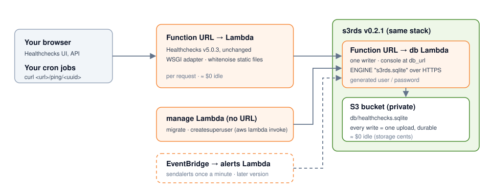

# lambdachecks — Healthchecks on AWS Lambda, ≈ $0 when idle

> **[Healthchecks](https://github.com/healthchecks/healthchecks)** (cron / scheduled-job monitoring) normally runs
> on an always-on server and database. **lambdachecks** runs the same Healthchecks release, **unchanged**, on one
> AWS Lambda behind a Function URL, with its database on **[s3rds](https://github.com/cloudformer/s3rds)**
> (SQLite on S3, serverless), deployed together as one stack. Nothing runs while nobody uses it. Only the host changes.

[中文](README.zh.md) · [changelog](CHANGELOG.md) · [moving to a normal deployment](MIGRATION.md)



| | Healthchecks self-hosted | lambdachecks |
|---|---|---|
| Code | Healthchecks v5.0.3 | the same release, unchanged (`hc/local_settings.py` only) |
| Web server | gunicorn, always on | one Lambda + Function URL (a small WSGI adapter) |
| Database | PostgreSQL / a SQLite file | s3rds v0.2.1 in the same stack: a Lambda + one private S3 bucket (`"ENGINE": "s3rds.sqlite"`) |
| Static files | whitenoise | whitenoise (collected + compressed at build time) |
| Idle cost / month | a VM + a database | ≈ $0 |
| Scale | any | small: MVP, dev / staging (tens of checks) |

## Who this is for: small scale — MVPs, side projects, dev / staging

Tens of checks, a few pings a minute, bursts of a few dozen at the same minute: ≈ $0 when idle, a few cents a
month in use. Every write (each ping) uploads the database file once and s3rds has one writer, so writes queue up:
- concurrent pings wait their turn (a busy writer is retried for ~10 s); keep `curl --retry 3` on ping clients;
- the larger the database, the slower each write.

Hundreds of checks, pings every second, or alerts that must fire within seconds: move to a normal Healthchecks
on PostgreSQL ([MIGRATION.md](MIGRATION.md)) — the same release, only the host and the database change.

## Status: 0.1.0

0.1.0 = Healthchecks runs on Lambda, the UI logs in (password login), the database is s3rds. Not yet: the alerts
Lambda (`sendalerts` once a minute from EventBridge), end-to-end pings, email, `sendreports` / pruning schedules,
the comparison suite against Healthchecks in Docker. Each comes with its own version.

## Quick start

Needs: Terraform, Docker running (the packages are built in AWS's Lambda Python images), the AWS CLI. One
`terraform apply` creates everything: Healthchecks' two Lambdas, and its database — s3rds' released server as a
Lambda plus a private S3 bucket, with a generated password.

### 1. Deploy

```bash
cp terraform/example.json terraform/real-lambdachecks.json   # aws_profile, secret_key
terraform -chdir=terraform init
terraform -chdir=terraform apply -var-file=real-lambdachecks.json   # first run: builds both architectures in Docker, minutes
terraform -chdir=terraform output                                   # url, manage_function, db_url, db_user
```

### 2. Set up in the browser

Open `url`. Until the first account exists, every page is the setup page; each step asks for the setup key,
which is `secret_key` from your variable file (so nobody else can claim a fresh deployment):

1. **Run migrations**: Healthchecks' and Django's migrations (about 200), run in the `lambdachecks-manage` function (it creates the
   database in s3rds first). One HTTPS call per statement: a few minutes; the page refreshes and shows
   `applied / total`. If it stops at the function's 15-minute limit, click again: it continues where it stopped.
2. **Create the account**: email + password of the first (super)user. Then you land on the login page.

The setup page is gone once that account exists. Without a browser:
`aws lambda invoke --function-name lambdachecks-manage --cli-binary-format raw-in-base64-out --payload '{"manage": ["migrate", "--noinput"]}' /dev/stdout`
(any `manage.py` command works the same way).

### 3. Log in

Sign in at `url` with that email and password. The database: open `db_url` (s3rds' console), sign in with
`db_user` and `terraform -chdir=terraform output -raw db_password`; Healthchecks' tables are in `healthchecks`.

```bash
terraform -chdir=terraform destroy -var-file=real-lambdachecks.json   # removes everything, the database (S3 bucket) too
```

## What differs from a normal Healthchecks

- **Sign-in**: password only for now (no email configured, so no magic links); `registration_open` false by default.
- **Concurrent writes**: two pings writing the same s3rds database at once can make one fail (HTTP 500); ping
  clients retry (`curl --retry 3`). Healthchecks on SQLite has the same class of behaviour ("database is locked").
- **Cold start**: the first request after a while loads Django (a few seconds).

## Repository layout

```
src/server/       lambda_function.py (WSGI adapter, setup page, manage entry), local_settings.py (-> hc/local_settings.py), requirements.txt
scripts/          build_server.py: both packages, per architecture (run by Terraform): Healthchecks + src/server,
                  s3rds' server (its release, unchanged)
terraform/        deployment: Healthchecks' Lambdas + s3rds (Lambda + S3 bucket), one stack
tests/            regression suite (the adapter); tests/compat/ the comparison suite (later)
```

---

Part of **[IdleFree](https://cloudformer.github.io/)** — AWS services and self-hosted apps rebuilt to cost ≈ $0 when
idle. MIT.
